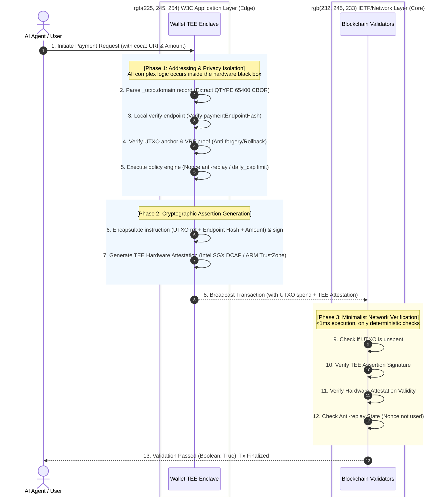

<p align="center">
  
</p>

<h1 align="center">UTXO Web Wallet Interoperability Community Group (UW2ICG)</h1>

<p align="center"><strong>Bridging Crypto and Regulated Fiat Wallets</strong></p>

<p align="center">
  
  
  
</p>


<h1 align="center">UTXO Web Wallet Interoperability Community Group (UW2ICG)</h1>

<p align="center">
  <strong>🌐 Bridging <span style="color:#0056b3;">Crypto</span> and <span style="color:#0056b3;">Regulated Fiat Wallets</span></strong>
</p>

This repository hosts the work of the **UTXO Web Wallet Interoperability Community Group** (UW2ICG), a W3C Community Group focused on defining **<span style="color:#0056b3;">open, vendor‑neutral specifications</span>** for **<span style="color:#0056b3;">cryptocurrency and fiat‑compliant wallets</span>** to integrate the IETF UTXO‑DNS protocol.

The group's deliverables enable:

- **<span style="color:#0056b3;">Compliant Digital Asset Payments</span>** – Seamless payments via **Web Payments API extension (`utxo-payment`)**, supporting both **native cryptocurrencies** and **<span style="color:#0056b3;">regulated stablecoins</span>** (**<span style="color:#0056b3;">USDC, USDT, HKDA</span>**).

- **<span style="color:#0056b3;">Self‑Sovereign Identity with KYC/AML</span>** – **Verifiable Credentials (vLEI)** integrated with **<span style="color:#0056b3;">real‑time compliance checks</span>**, enabling secure, regulated identity for both individuals and legal entities.

- **<span style="color:#0056b3;">Cross‑Border Payment Routing</span>** – **Jurisdiction‑aware address resolution** with built‑in **<span style="color:#0056b3;">compliance hooks</span>** (**<span style="color:#0056b3;">sanction screening</span>**, **<span style="color:#0056b3;">transaction monitoring</span>**, **<span style="color:#0056b3;">audit trails</span>**).

- **<span style="color:#0056b3;">Wallet Interoperability</span>** – A **standardized `navigator.utxo` API** for browsers and a **wallet‑web messaging protocol** (`window.postMessage`), enabling seamless interaction between web applications and wallets across **<span style="color:#0056b3;">crypto and fiat rails</span>**.

- **<span style="color:#0056b3;">Regulatory Alignment</span>** – Full alignment with major global stablecoin and digital asset regulatory frameworks, including **<span style="color:#0056b3;">EU MiCA</span>** (fully effective in 2025), **<span style="color:#0056b3;">Hong Kong Stablecoins Ordinance (Cap. 656)</span>**, **<span style="color:#0056b3;">US GENIUS Act</span>**, **<span style="color:#0056b3;">Singapore MAS stablecoin framework</span>**, and **<span style="color:#0056b3;">Japan's Payment Services Act</span>** amendments, ensuring wallet interoperability **<span style="color:#0056b3;">does not compromise compliance</span>** across jurisdictions.

---

🔗 **Key Resources:**
- [Charter](./charter/charter.md) – Group scope and deliverables
- [Reference Implementation](https://github.com/cocafoundation6/utxo6-dns) – UTXO6-DNS protocol implementation
- [IETF Draft](https://www.ietf.org/ietf-ftp/internet-drafts/draft-guorong-utxo-dns-01.html) – UTXO-DNS wire protocol standardization
- [Join the CG](https://www.w3.org/community/uw2i/join) – Participate in the community group

## Status

This is a **Work in Progress (WIP)**. The group is collecting implementation experience.

The community will consider as input to its work **[`draft-guorong-utxo-dns-01`](https://www.ietf.org/ietf-ftp/internet-drafts/draft-guorong-utxo-dns-01.html)** (UTXO6-DNS: Base Protocol and PRN Regulatory Extensions).

Reference implementation: **[UTXO6-DNS v0.1.0](https://github.com/cocafoundation6/utxo6-dns/releases/tag/v0.1.0)**


## Repository Structure
- `spec/` - Specification source files (Bikeshed & HTML)
- `explainers/` - Supplementary materials (Charter, Use Cases)
- `api/` - WebIDL definitions


## Contributing
Feedback and pull requests are welcome. Please refer to the [Contribution Guidelines](CONTRIBUTING.md).

## Key Resources

- **Reference Implementation:** [`cocafoundation6/utxo6-dns`](https://github.com/cocafoundation6/utxo6-dns)
  - **Pluggable Wallet SDK:** [`integrations/tee-wallet-pluggable/`](https://github.com/cocafoundation6/utxo6-dns/tree/main/integrations/tee-wallet-pluggable) – A modular, pluggable SDK demonstrating UTXO-DNS resolution, TEE verification, multi-chain transactions, IPv6 visualization, and vLEI compliance in a single cohesive framework.
 
docs: add pluggable UTXO TEE wallet SDK reference to README


# Whitepaper: coca: A Payment Addressing Communication Protocol

**Version:** v1.0 (Official Release)
**Publisher:** CoCa Foundation
**Date:** November 2026

---

## Table of Contents
1. [Abstract](#abstract)
2. [Introduction](#introduction)
3. [Chapter 1: Market Context](#chapter-1-market-context)
4. [Chapter 2: The coca Mechanism](#chapter-2-the-coca-mechanism)
5. [Chapter 3: Technical Architecture & Anti-Fork Design](#chapter-3-technical-architecture)
6. [Chapter 4: Lifecycle State Machine](#chapter-4-lifecycle-state-machine)
7. [Chapter 5: Engineering & 15 Core Security Test Cases](#chapter-5-engineering-test-cases)
8. [Chapter 6: Standards & Compliance Moat](#chapter-6-standards-compliance)
9. [Chapter 7: Investment Equity, Agency Implementation, and Regional Distribution Framework](#chapter-7-business-model)
10. [Conclusion](#conclusion)

---

## Abstract

The current global payment network is highly fragmented. Although systems such as PayPal, Visa, USDC/USDT, and Bitcoin (BTC) have significantly improved the efficiency of fund movement, the starting point of the payment link—the "addressing declaration authority" (which endpoint should receive the funds)—remains encapsulated within centralized APIs, account risk controls, and routing rules. Merchants must repeatedly configure endpoints and undergo reviews across different gateways, bearing high addressing premiums and lock-in risks.

This paper proposes a payment addressing communication protocol based on native DNS protocols and TEE (Trusted Execution Environment). By introducing the `coca:` communication header and the `_utxo` namespace, we construct an independently verifiable addressing declaration layer that does not rely on any single payment institution. At the protocol level, we actively reject the burden of exacerbating public RRTYPE space congestion and transparent DNS-layer parsing. Instead, we utilize the RFC 3597 Private-use space (QTYPE 65400) for opaque CBOR byte stream transmission. Combined with TEE hardware-level lifecycle state machine verification and the engineering implementation of 15 core security test cases, this protocol achieves seamless interoperability across traditional fiat, stablecoin, and cryptocurrency clearing channels.

## Introduction

Traditional payment APIs give merchants a rented key that can be revoked at any time; however, through this lifecycle state machine featuring grace periods, on-chain anchoring, and hardware cryptographic endorsement, we hand merchants a property deed that bears their name and is protected by both mathematical and physical certainty.

From now on, consumer payment rights and merchants' receiving endpoints are no longer appendages of the platform, but a truly cross-platform, censorship-resistant, and tamper-proof "Consumer Capital".

---

## Chapter 1: Market Context

Currently, the addressing declaration authority for mainstream payment methods is locked by institutions, creating unavoidable fragmentation:
*   **PayPal**: Addressing is bound to account risk control. Funds are withheld for 21-180 days; merchants cannot declare their true endpoints.
*   **Visa**: Addressing is filtered by acquirers and the VAMP monitoring system. Merchants pay a 2-3.5% comprehensive cost but only gain a passive submission qualification.
*   **USDC/USDT**: Although settlement is decentralized, it is re-intermediated by gateways like Stripe (1.5% addressing premium).
*   **BTC**: A decentralized asset, yet its address addressing rights are custodied by payment processors.

**Why do we need "Consumer Domains"?**
Traditional DNS only solves "where the network goes," not "who the funds are paid to." A merchant only needs a consumer domain like `jmbc.user.utxo6.com` to establish their own publicly verifiable payment endpoint declaration on top of various payment platforms.

---

## Chapter 2: The coca Mechanism

We defined the `coca:` communication header as an instruction to wake up payment applications and request authorization, decoupling the application layer from the network layer.

### 2.1 Standard Instruction Format
**Full Format:** `coca:https://jmbc.user.utxo6.com`
*   **`coca:`** Wakes up the local client (e.g., wallet or Web3 browser) and initiates authorization and resolution requests.
*   **`https://`** Enforces the establishment of a DoH (DNS over HTTPS) encrypted transmission channel to prevent man-in-the-middle eavesdropping.
*   **`jmbc`** Routing identifier. Indicates that this payment intent requires access to the Jonathan Central Bank Bridge for institutional-level compliant clearing.
*   **`user.utxo6.com`** The Consumer Domain entity, pointing to the merchant's identity and endpoint carrier.

### 2.2 Four Core Business Values

#### Value 1: From "Platform Rental" to "Autonomous Property Rights" (Assetization)
*   **Web2 Status Quo**: A merchant's "receiving capability" on PayPal or e-commerce platforms is rented. If the account is frozen or banned, the merchant not only loses money but also loses the "entry point where customers can find them."
*   **Coca Value**: Through `REGISTER` and `TRANSFER` operations (mapped to on-chain Identity Anchor UTXOs), the consumer domain becomes a digital asset truly owned by the merchant.
*   **Transferable & Inheritable**: Merchants can transfer the domain as an asset or use it as on-chain collateral for financing.
*   **Censorship-Resistant**: No payment platform can unilaterally shut down or confiscate your domain. As long as the private key is in the merchant's hands, the addressing right belongs to the merchant.
*   **Asset Premium**: Short, memorable domains (e.g., `pay.utxo6.com`) will have immense commercial premium space, creating a decentralized domain trading market.

#### Value 2: Business Fault Tolerance via "Grace Period" (Risk Control)
*   **Web2 Status Quo**: If you forget to renew a domain or a Stripe API config fails, your business instantly paralyzes without a buffer.
*   **Coca Value**: The `GRACE_PERIOD` (typically 90 days) in the state machine, combined with TEE local verification, provides high commercial fault tolerance.
*   **Smooth Transition**: Even if the merchant's on-chain identity anchor briefly expires, during the grace period, the TEE will still issue a low-risk "yellow warning" to allow business to continue.
*   **Anti-Cybersquatting**: Only the legitimate owner holding the original private key can initiate renewal (`UPDATE`) during the grace period. After the grace period, anyone can release the resource via `RECLAIM`. This mechanism completely eliminates the possibility of hackers using platform backdoors to strip a merchant's domain.

#### Value 3: "Zero-Trust Security" Endorsed by Hardware Cryptography (Security)
*   **Web2 Status Quo**: Merchants rely on the black-box risk control of platform APIs. If the platform server is hacked or DNS cache is poisoned, the merchant and user are completely unaware.
*   **Coca Value**: The introduction of TEE (e.g., HarmonyOS/Intel SGX) hardware enclaves and VRF cryptographic proofs (Test cases T5/T8/T9 passed) shifts addressing security from "relying on centralized institutions" to "mathematical certainty."
*   **Eliminate Address Tampering**: Even if a hacker compromises the Alibaba Cloud DNS server and modifies the RDATA, since they cannot forge the `addressBookHash` and VRF signature within the TEE, the user's mobile TEE will directly intercept and alert.
*   **Anti-Replay & Anti-Fork**: Every state transition is bound to a monotonically increasing Nonce (T11). Even if a 51% fork or rollback occurs on the blockchain, the uniqueness of the TEE hardware state ensures historical transactions are never maliciously replayed. Oversized payloads (>512 bytes) are also circuit-broken and rejected by the TEE (T14).

#### Value 4: "Universal Routing Anchor" for Multi-Chain and Fiat (Interoperability)
*   **Web2 Status Quo**: To receive fiat, USDT, and BTC, merchants must open accounts at Stripe, banks, and crypto gateways, managing different address lifecycles separately.
*   **Coca Value**: The `UPDATE` operation allows merchants to update multi-chain endpoints in their CBOR mapping under a single unified domain.
*   **One-Stop Management, Global Interconnection**: Merchants only need one lifecycle via `user.utxo6.com` to switch underlying clearing channels at any time (e.g., Visa today, JMBC tomorrow).
*   **Sovereignty Declaration**: This is equivalent to merchants planting a flag that never falls on the high seas of the Internet (DNS). No matter how underlying payment channels change, customers always know where to pay.

---

## Chapter 3: Technical Architecture & Anti-Fork Design

### 3.1 End-to-End Architecture

**Figure 1: coca Protocol End-to-End Addressing and Clearing Sequence Diagram**

This sequence diagram includes the AI Agent/User, TEE (W3C Application Layer), and Blockchain Validators (IETF/Network Layer), illustrating the complete flow: Addressing, Verification, Assertion Generation, Transaction Submission, and Minimalist Network Verification.
*   **Phase 1: Addressing & Privacy Isolation** (DNS parsing, endpoint hash verification, VRF validation, policy engine).
*   **Phase 2: Cryptographic Assertion Generation** (Encapsulation, hardware signing, TEE credential generation).
*   **Phase 3: Minimalist Network Verification** (Check UTXO, verify signature, verify TEE credential, anti-replay check).

By isolating complex business logic inside the TEE hardware enclave (blue area), the network layer validators (green area) only perform minimal Boolean checks. This "heavy edge, light core" design protects commercial privacy, enables high-frequency micropayments (<1ms), and completely cuts off malicious nodes from forging addressing records.



### 3.2 Opaque Binary Data Layer (Opaque RDATA)
At the protocol level, we actively reject the burden of exacerbating public RRTYPE space congestion and transparent DNS-layer parsing. We adopt the RFC 3597 Private-use space (QTYPE 65400), strictly bound with the `_utxo` prefix (e.g., `_utxo.user.utxo6.com`). The RDATA is purely an opaque CBOR byte stream. The DNS network acts only as a transparent transmission and caching layer, never parsing its content.

### 3.3 Local Terminal Verification (TEE & VRF)
Addressing security verification is performed entirely on the client side. After retrieving the RDATA, wallets or TEEs (such as HarmonyOS TEE or Intel SGX) locally decode the CBOR and verify the VRF proofs and TEE attestations within. A payment is only initiated after confirming that the Payment Endpoint Hash matches the domain declaration.

### 3.4 Cryptographic Anti-Fork Mechanism Based on BTC-UTXO
When the underlying blockchain experiences a 51% attack, fork, or rollback, the `coca:` protocol remains unaffected:
1.  **DNS Layer Transparency**: It is only responsible for transmitting the merchant's declaration, not adjudicating authenticity.
2.  **State Commitment Comparison**: TEE verifies whether the UTXO on the forked chain carries the same Taproot/MAST commitment root. If the commitment root on the forked chain is maliciously tampered with, the TEE directly rejects that chain's UTXO as the identity anchor.
3.  **Local Monotonic Increment State (Anti-Replay)**: Even if the underlying chain rollback resurrects old transactions, the independent Nonce sequence maintained internally by the TEE will immediately intercept the transaction once it detects it has been consumed, ensuring the fork cannot "double-spend" the domain's addressing right.

---

## Chapter 4: Consumer Domain Lifecycle State Machine

The lifecycle of a Consumer Domain is driven by four core primitives. Every state transition is strictly constrained by TEE cryptographic verifications.

**Figure 2: Consumer Domain Lifecycle State Machine**

```mermaid
stateDiagram-v2
    direction TB
    [*] --> AVAILABLE: Initial State

    AVAILABLE --> ACTIVE: REGISTER\n(Create Identity Anchor UTXO + Write CBOR record)
    note right of AVAILABLE: TEE Verification:\nDomain hash does not exist\n& TEE proof is valid

    state ACTIVE {
        [*] --> Valid
        Valid --> Valid: UPDATE\n(Sign to update CBOR endpoint mapping)
        Valid --> Valid: TRANSFER\n(Transfer owner public key / Multi-sig)
    }
    
    note left of ACTIVE: TEE Verification Rules:
    note left of ACTIVE: 1. UTXO Unspent (T12)
    note left of ACTIVE: 2. Signature & Nonce Valid (T11)
    note left of ACTIVE: 3. Endpoint Hash Match (T8/T9)

    ACTIVE --> GRACE_PERIOD: Timestamp > expires_at\n(Triggered by block height or TEE time)
    note right of GRACE_PERIOD: Grace Period (e.g., 30-90 days)\nOriginal owner can renew during this time

    GRACE_PERIOD --> ACTIVE: Renewal\n(Pay renewal fee & update expires_at)
    
    GRACE_PERIOD --> EXPIRED: Grace Period Timeout
    note right of EXPIRED: Domain becomes dead\nAnyone can initiate reclaim

    EXPIRED --> AVAILABLE: RECLAIM\n(Trigger reclaim script)
    note right of EXPIRED: Reclaimer receives incentive\nOriginal Identity Anchor UTXO is spent & destroyed
```

*Caption: The lifecycle of a Consumer Domain is driven by four core primitives. Every state transition is strictly constrained by TEE cryptographic verifications (referencing test cases T8, T9, T11, T12), ensuring that domain ownership and endpoint mappings cannot be forged or hijacked.*

---

## Chapter 5: Engineering & 15 Core Security Test Cases

This protocol is not a theoretical deduction. The underlying engine has completed 15 security tests locally (100% PASS), covering the entire chain from DNS parsing to TEE hardware verification.

| Test Case | Objective | Result |
| :--- | :--- | :--- |
| **T1** | Experimental mode TBD1 passes normally | PASS |
| **T2** | Production mode TBD1 rejected (enforces official code) | PASS |
| **T3** | Production mode official code passes | PASS |
| **T4** | VRF missing: assertion has no fingerprint, Validator passes | PASS |
| **T5** | VRF exists and proof is valid | PASS |
| **T6** | Forged VRF proof rejected | PASS |
| **T7** | `ext` unknown field safely ignored | PASS |
| **T8** | `tx.to` tampering rejected (endpoint hash mismatch) | PASS |
| **T9** | `addressBookHash` tampering rejected | PASS |
| **T10** | `dailyCap` exceeded rejected (limit circuit breaker) | PASS |
| **T11** | `nonce` replay rejected | PASS |
| **T12** | UTXO spent rejected (lifecycle failure) | PASS |
| **T13** | Wildcard/CNAME transparent, no dependency on special DNS handling | PASS |
| **T14** | Payload oversized rejected (RDATA > 512 bytes intercepted) | PASS |
| **T14b** | Payload exactly 512 bytes passes | PASS |

*Note: The T14 test cases strictly defend against Denial of Service (DoS) attacks where attackers construct oversized CBOR payloads to exhaust TEE memory or trigger DNS fragmentation amplification.*

---

## Chapter 6: Standards & Compliance Moat

### 6.1 The "Private Space + Prefix" Consensus, Bypassing the IETF Quagmire
During the IETF DNSOP community's debate over "RRTYPE generality," we adopted the advice of experts (Mukund, Ray, etc.) to complete engineering implementation using the RFC 3597 Private-use space (65400) combined with the `_utxo` prefix. This specification has been officially archived as `draft-guorong-utxo-dns-03` in the IETF database.

### 6.2 ISO 20022 Extension Declaration
The Belgian entity (AISBL) serves as the sole submitting organization, mapping the endpoint information parsed by `coca:` into the `SupplementaryData` structured container of the `pacs.008` message. Led jointly by Sean (Legal, Canadian licensed lawyer) and Guorong Tian (Technical), targeting global institutional endorsement.

### 6.3 Compliance Firewalls Across Jurisdictions
*   **Mainland China (Zhongshiyuan)**: As the sole ICP filing entity for `utxo6.com`. Hainan scenarios only provide "addressing information routing services" and do not touch fund pools.
*   **Hong Kong (HKBC)**: Docking with the stablecoin licensing sandbox to ensure liquidity compliance.
*   **European Union**: Providing regulatory perspectives on MiCA and PSD2. We broadly welcome European local compliant institutions and standards entities to join us for deep collaboration.

---

## Chapter 7: Investment Equity, Agency Implementation, and Regional Distribution Framework

1.  **Open to All Investors**: The Foundation retains core wholesale pricing power and is fully open to global investors and regional agencies for cooperation.
2.  **Generalized Regional Distribution**: Whether in the Asia-Pacific or the EU region, we do not impose exclusive, locked-in thresholds. Institutions with financial strength and local compliance capabilities (e.g., Ronghua, or other licensed entities) are highly encouraged to actively join and co-build the registrar economy ecosystem based on Consumer Domains, sharing the commercial growth dividends.
3.  **The "Registrar Economy" of Consumer Domains**: The Foundation retains wholesale pricing power, while regional licensees (e.g., Ronghua) execute retail distribution.
4.  **Third-Party Wallet Agency Recruitment (B2B2C)**: Recruiting "Implementing Members" from top wallets like imToken, charging an agency annual fee ($10/address) to rapidly establish early cash flow for the Foundation.
5.  **Addressing Technology Service Fees**: Zhongshiyuan provides routing and addressing technology service fees domestically; PT COCA collects channel fees in Southeast Asian energy RWA settlements.

---

## Conclusion

`user.utxo6.com` (Consumer Domain) does not replace any existing payment channels. It simply separates the declaration authority of "where to pay and which channels to accept" from the black-box APIs of major institutions and writes it into a public DNS record controlled by the domain holder.

Settlement can continue to flow through any compliant channel, but the control over the addressing layer must be returned to the merchant. This is the entire significance of building the `coca:` protocol.

---

## Appendix

*   **Appendix A:** Core summary and official link of the `draft-guorong-utxo-dns-03`.
*   **Appendix B:** Full report on 15 TEE security test cases.
*   **Appendix C:**  Glossary (UTXO, TEE, CBOR, QTYPE 65400, JMBC, etc.).

*  ## 🤝 Ecosystem & Partnerships

We welcome all developers to implement this specification. For official interoperability certification (Interop Certification) and commercial deployment partnerships, please contact the CoCa Foundation.

Contact: foundation@utxocp.cn 
